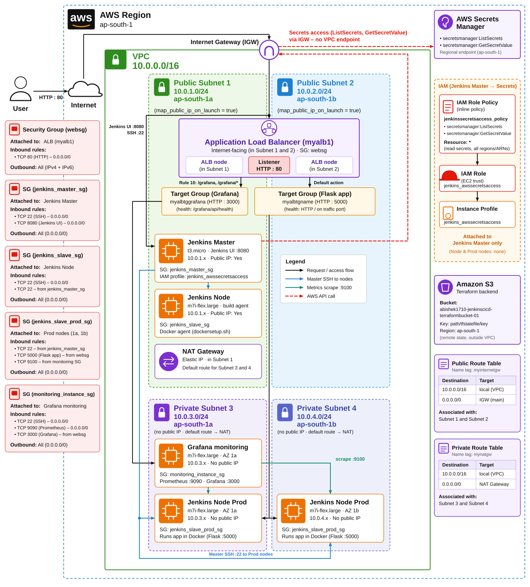

# AWS Terraform — Jenkins CI/CD

## Overview

This Terraform project provisions an AWS VPC and EC2-based Jenkins CI/CD infrastructure. It includes Terraform configurations, helper scripts for Jenkins and Docker agent setup, and an architectural diagram illustrating the deployment.

## Architecture



## Repository Contents

- **Terraform files**: `main.tf`, `backend.tf` — core configuration and backend setup.
- **Modules**: `modules/ec2_instance/` — EC2 instance definitions and variables.
- **Scripts**: `dockersetup.sh`, `jenkinssetup.sh` — helper scripts used by instances.
- **Service units**: `prometheusserver.service`, `grafanaserver.service`, `nodeexporterservice.service` (not documented here).
- **Secrets/Notes**: `jenkinsawssecrets.md` — contains guidance about Jenkins AWS credentials (keep this secure).

## Prerequisites

- Terraform 1.0+ installed and configured.
- AWS CLI configured with appropriate credentials and permissions to create VPC, EC2, IAM roles, Security Groups, and Load Balancers.

## Quick Start (preferred workflow)

Use the following Terraform workflow that this repository follows:

1. Initialize the working directory and download modules/providers:

```bash
terraform init
```

2. Validate configuration syntax and catch errors early:

```bash
terraform validate
```

3. Create and review an execution plan (interactive display):

```bash
terraform plan
```

4. Apply the planned changes:

```bash
terraform apply
```

5. Destroy the infrastructure when no longer needed:

```bash
terraform destroy
```

After provisioning, run `jenkinssetup.sh` on the Jenkins master instance to complete Jenkins configuration.

## Module: EC2 Instance

The `modules/ec2_instance` module defines EC2 instance resources and inputs. See [modules/ec2_instance/main.tf](modules/ec2_instance/main.tf) and [modules/ec2_instance/variables.tf](modules/ec2_instance/variables.tf) for configurable options such as instance type, AMI, subnet, and user-data scripts.

## Helpful Scripts

- `dockersetup.sh`: Installs Docker and configures the agent images used by Jenkins build nodes.
- `jenkinssetup.sh`: Performs post-provisioning setup on the Jenkins master (plugins, initial admin user, credentials integration).

## Security Notes

- Do not commit secrets. Use IAM roles and AWS Secrets Manager where possible.
- `jenkinsawssecrets.md` documents the expected secret names and least-privilege IAM policies required.

## Exclusions

This README intentionally omits Prometheus, Grafana, and Node Exporter configuration details — those components are present in the repository but are not documented here.

## Support

If you need changes or want monitoring/docs added, open an issue or contact the repository owner.
